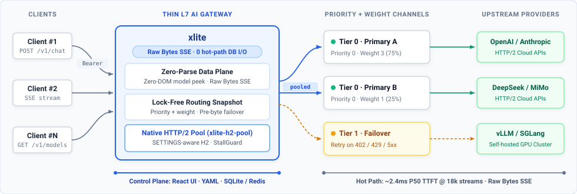
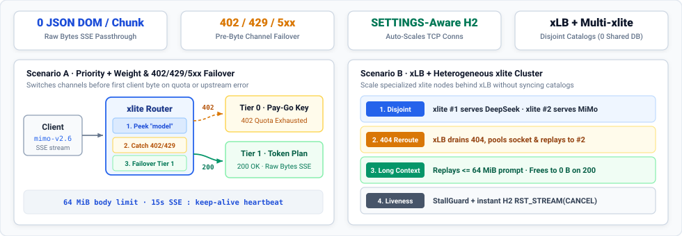
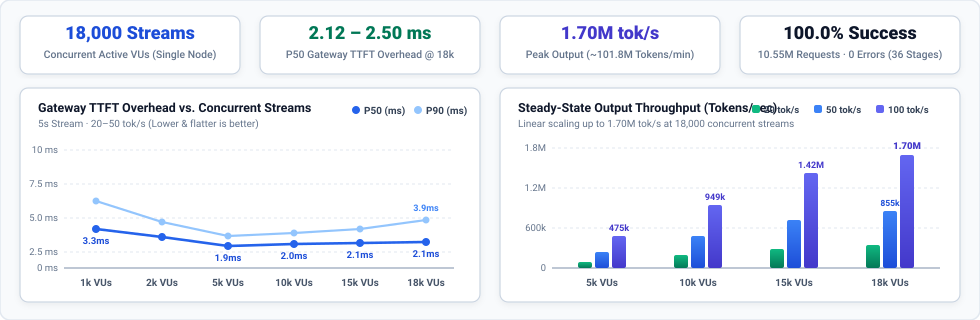

# xlite

**xlite** is a headless, ultra-thin, multi-protocol AI traffic gateway written in Rust. It isolates **model channel scheduling and failover (`priority + weight + pre-first-byte failover`)** and **multi-protocol translation (`/v1/chat/completions`, `/v1/messages`, `/v1/responses`, `/v1/embeddings`)** into a **zero-hot-path-DB-I/O Rust data plane** backed by a purpose-built 10k+ streaming HTTP/2 connection pool (`xlite-h2-pool`), controlled programmatically via a stateless REST API (`Authorization: Bearer <ADMIN_PASSWORD>`) or GitOps YAML catalog.

<p align="center">
  
</p>

## Why xlite

Full-stack AI gateways ([LiteLLM](https://github.com/BerriAI/litellm), [New API](https://github.com/QuantumNous/new-api)) parse full JSON request trees, query PostgreSQL/MySQL/Redis on every request for quotas, and deserialize every outbound `data: {...}` SSE chunk. Under 10,000+ concurrent streams, the gateway itself becomes the CPU and TTFT bottleneck.

- **Raw `Bytes` Zero-Parse SSE Passthrough** — On ingress, `xlite` peeks only the top-level `"model"` field without building a JSON DOM (forwarding the original `Bytes` buffer untouched when `upstream_model == model`). On egress, SSE chunks stream directly as raw `Bytes` frames with zero JSON parsing, line splitting, or re-serialization ([deep dive](docs/architecture.md#2-zero-parse-data-plane-srcproxyrs)).
- **`priority + weight` Channel Scheduling & Pre-First-Byte Failover** — Groups channels for a public model by `priority` ascending (`0` = primary tier; `1, 2, …` = backup tiers), load-balances within each tier by `weight`, and fails over transparently **before the first response byte** on TCP/H2 dial errors, header timeouts, `402`, `429`, or `5xx` ([deep dive](docs/architecture.md#4-priority--weight-routing--pre-first-byte-failover)).
- **Purpose-Built 10k+ Streaming HTTP/2 Pool (`xlite-h2-pool`)** — Standard `reqwest` reuses a single HTTP/2 connection per host and queues streams internally once `SETTINGS_MAX_CONCURRENT_STREAMS` fills up. `xlite-h2-pool` reads live peer `SETTINGS` during the handshake and scales TCP connections horizontally up to `XLITE_UPSTREAM_MAX_CONNS_PER_HOST`, paired with `StallGuard` and instant `RST_STREAM(CANCEL)` propagation ([deep dive](docs/architecture.md#5-native-upstream-http2-pool-xlite-h2-pool)).
- **0 Hot-Path DB I/O + Single-Binary Web Console** — Precomputes SHA-256 API key hashes, channel tiers, and HTTP headers into a lock-free in-memory snapshot ([deep dive](docs/architecture.md#3-lock-free-arcswap-snapshot-srcstorers)), while embedding a complete React Admin Console, GitOps YAML import/export, and pluggable **SQLite / In-Memory / Redis** catalog storage in one static binary.

<p align="center">
  
</p>

| Dimension | **xlite** | **[LiteLLM](https://github.com/BerriAI/litellm)** | **[New API](https://github.com/QuantumNous/new-api)** | **[AISIX OSS](https://github.com/api7/aisix)** |
| :--- | :--- | :--- | :--- | :--- |
| **Runtime & Role** | **Rust · Ultra-thin OpenAI streaming load balancer** | Python · Multi-SDK adapter & spend governance | Go · Multi-tenant SaaS billing & quota portal | Rust · Full protocol-translation & Agent gateway |
| **SSE Streaming Path** | **Raw `Bytes` zero-parse passthrough** | Per-chunk JSON parse & Python object build | Per-chunk JSON parse & token accounting | SSE parser + cross-protocol translation |
| **Hot-Path DB / Redis I/O** | **0 queries** (lock-free routing snapshot) | Per-request auth, rate-limit & spend I/O | Per-request auth, quota & billing I/O | 0 queries (`ArcSwap`) |
| **Upstream Connection Pool** | **Peer `SETTINGS`-aware `xlite-h2-pool` + `RST_STREAM(CANCEL)`** | `httpx` / `aiohttp` | Go `net/http` transport | Standard `reqwest` / `hyper` |
| **Built-in Web Console** | **Yes (single binary, stateless HMAC cookie)** | Yes | Yes (full user + admin portal) | **No in OSS** (Enterprise/Cloud only) |

## Performance Highlights

Single-node benchmark (**28 vCPU** pinned to `xlite`, 24 upstream `h2c` SSE mock instances with 500 ms base TTFT, **10.55M total requests** across 36 stages from 1,000 to 18,000 concurrent streams — full 36-stage tables and root-cause ablations in [`docs/benchmarks.md`](docs/benchmarks.md)):

<p align="center">
  
</p>

## Quick Start

**Option 1 — Docker (all-in-one gateway + Web Console):**

```bash
docker run -d --name xlite -p 8080:8080 \
  -e ADMIN_PASSWORD=admin \
  -v xlite-data:/opt/xlite/data \
  -e DATABASE_URL=sqlite:/opt/xlite/data/xlite.db \
  ghcr.io/eeroeternal/xlite:latest
```

**Option 2 — Pre-built Single Binary:**

```bash
# Download the release binary for your OS/Arch, then start:
ADMIN_PASSWORD=admin ./xlite
```

Open the Web Console at **`http://127.0.0.1:8080`** to configure providers, `priority + weight` channels, and API keys visually—or import [`examples/catalog.yaml`](examples/catalog.yaml) in one click (`Settings → Import YAML` or `xlite import examples/catalog.yaml --replace`; see [`deploy/env.example`](deploy/env.example) for runtime environment variables). Then send an OpenAI streaming request:

```bash
curl -N http://127.0.0.1:8080/v1/chat/completions \
  -H "Authorization: Bearer sk-loadtest" \
  -H "Content-Type: application/json" \
  -d '{"model":"mock","stream":true,"messages":[{"role":"user","content":"hi"}]}'
```

## Documentation

- [Architecture & Technical Deep Dive](docs/architecture.md) — zero-parse data plane, `ArcSwap` snapshot, routing/failover walkthrough, `xlite-h2-pool`, and `StallGuard`
- [Single-Node Benchmarks & Root-Cause Ablations](docs/benchmarks.md) — 36-stage load test (1k–18k VUs, 10.55M requests) and HTTP/2 & `RLIMIT_NOFILE` ablations
- [Operator Manual & Configuration Reference](docs/manual/xlite.md) — all `XLITE_*` environment variables, storage modes (`SQLite` / `memory` / `Redis`), and pool tuning
- [Getting Started Guide](docs/getting-started.md) — 5-minute closed-loop setup, YAML catalog workflow, and `/health` & `/ready` probes
- [Docker Compose Deployment (`xlite` + Redis)](deploy/README.md) — production-ready single-node or multi-replica (`--profile ha`) Docker Compose stack
- [Changelog](docs/changelog.md) — release history
