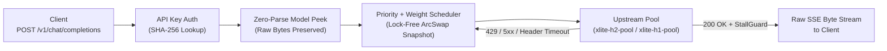

<div align="center">

# xlite

**Ultra-fast, zero-parse LLM API gateway written in Rust.**  
Transparent SSE byte-stream passthrough · Lock-free `ArcSwap` routing · Pre-first-byte failover

[](https://github.com/EeroEternal/xlite/releases)
[](https://www.rust-lang.org/)

[Getting Started](docs/getting-started.md) · [Architecture](docs/architecture.md) · [Deployment](deploy/README.md) · [Changelog](docs/changelog.md)

</div>

---

## Why xlite?

Most AI gateways sit on the critical path of every token: they deserialize JSON requests, query a database or Redis for user quotas, and parse every Server-Sent Events (SSE) chunk on the way back. Under high concurrency, the gateway itself becomes the latency and CPU bottleneck.

**xlite** is designed strictly as a **high-throughput, low-latency L7 data plane** for OpenAI-compatible LLM traffic:

- **Zero-Parse SSE Passthrough**: Inspects only the top-level `"model"` field on ingress (`serde::de::IgnoredAny` skips the rest of the payload) and pipes upstream SSE response chunks as raw `Bytes` with zero JSON re-serialization.
- **Zero Storage I/O on the Hot Path**: All API keys, model bindings, pre-sorted priority groups, and upstream `HeaderName`/`HeaderValue` pairs are precomputed into an in-memory snapshot managed by lock-free `ArcSwap`. The request path never touches SQLite or Redis.
- **Priority + Weighted Failover**: Follows the battle-tested channel scheduling model (weighted random within the lowest priority number) and automatically fails over to backup channels on connection errors, header timeouts, `429 Too Many Requests`, or `5xx` before the first response byte is sent.
- **Purpose-Built Upstream Pools**:
  - **`xlite-h2-pool`**: Custom HTTP/2 multiplexing pool that tracks peer `SETTINGS_MAX_CONCURRENT_STREAMS` in real time and scales connections only when streams saturate.
  - **`xlite-h1-pool`**: Bounded HTTP/1.1 keep-alive pool with LIFO idle socket reuse and strict per-host concurrency admission (`XLITE_UPSTREAM_MAX_CONNS_PER_HOST`).
- **Two-Stage Stream Guard**: Independently guards time-to-first-response-header (`XLITE_UPSTREAM_HEADER_TIMEOUT_MS`) and mid-stream token stalls (`XLITE_UPSTREAM_STREAM_IDLE_TIMEOUT_MS`).
- **Single Binary + Built-in Console**: Ships as a single static binary with an embedded React operational console, declarative YAML catalog import/export (`xlite import` / `xlite export`), and flexible persistence (SQLite, In-Memory, or Redis cluster).

---

## How xlite Compares

| Feature / Architecture | **xlite** | **new-api** | **Apache APISIX (AI Gateway)** |
| :--- | :--- | :--- | :--- |
| **Runtime** | **Rust** (`tokio` + `axum` + `hyper`) | Go (`gin`) | Nginx + LuaJIT + `etcd` |
| **SSE Streaming Path** | **Raw `Bytes` passthrough (zero chunk parsing)** | Per-chunk JSON parse & re-encode | Lua phase hooks & buffering |
| **Request-Path DB / Redis I/O** | **0 queries** (lock-free `ArcSwap` snapshot) | Per-request auth, quota & billing I/O | In-memory via `etcd` sync |
| **Upstream HTTP/2 & HTTP/1.1** | **SETTINGS-aware H2 pool + bounded LIFO H1 pool** | Standard `net/http` transport | Nginx upstream keepalive |
| **Pre-computed Wire Headers** | **Yes** (validated & cached on catalog reload) | Constructed per request | Constructed per request |
| **Deployment Footprint** | **1 binary** (SQLite / Memory / Redis) | Binary + MySQL/PostgreSQL + Redis | OpenResty + `etcd` control plane |
| **Target Use Case** | **High-concurrency LLM routing & failover data plane** | Multi-tenant SaaS portal, billing & format hub | Enterprise general API gateway |

---

## Quick Start

### 1. Run from Source

```bash
export ADMIN_PASSWORD=admin
cargo run --release
```

By default, `xlite` listens on `0.0.0.0:8080` and persists configuration to `sqlite:xlite.db`.

```bash
# In-memory mode (for zero-disk load testing / benchmarking)
DATABASE_URL=memory ADMIN_PASSWORD=admin cargo run --release

# Cluster mode (shared catalog across nodes via Redis)
REDIS_URL=redis://127.0.0.1:6379 ADMIN_PASSWORD=admin cargo run --release
```

### 2. Declarative Catalog (GitOps YAML)

Import and export providers, models (channels), and API keys via CLI or HTTP API:

```bash
# Replace or merge catalog from YAML
xlite import examples/catalog.yaml --replace
xlite export catalog.yaml
```

### 3. Docker Compose (with 24 Upstream Mocks + Redis)

See [`deploy/README.md`](deploy/README.md) for containerized deployment and load-test topology:

```bash
cd deploy
cp env.example .env
docker compose up -d --build
docker compose run --rm xlite import /opt/xlite/examples/mock-24.docker.yaml --replace
```

---

## Architecture & Request Lifecycle



### Core Endpoints

| Method | Path | Description |
| :--- | :--- | :--- |
| `POST` | `/v1/chat/completions` | OpenAI-compatible chat completion proxy (streaming & non-streaming) |
| `GET` | `/v1/models` | Lists public models available to the caller's API key |
| `GET` | `/health` | Liveness probe (process up) |
| `GET` | `/ready` | Readiness probe (catalog snapshot healthy) |
| `*` | `/api/*` | Control-plane REST API & built-in Admin UI |

---

## Configuration

| Environment Variable | Default | Description |
| :--- | :--- | :--- |
| `LISTEN_ADDR` | `0.0.0.0:8080` | Listen address (`HOST:PORT`) |
| `DATABASE_URL` | `sqlite:xlite.db` | SQLite path (`sqlite:...`) or `memory` |
| `REDIS_URL` | *(unset)* | Redis URL (`redis://...`) for shared cluster catalog |
| `ADMIN_PASSWORD` | *(required)* | Admin UI & `/api/*` password |
| `XLITE_CATALOG_RELOAD_SECS` | `5` | Background catalog snapshot refresh interval (`0` to freeze) |
| `XLITE_UPSTREAM_MAX_CONNS_PER_HOST` | `128` | Max upstream connections / in-flight HTTP/1.1 requests per host |
| `XLITE_UPSTREAM_HEADER_TIMEOUT_MS` | `30000` | Timeout waiting for upstream response headers (`0` to disable) |
| `XLITE_UPSTREAM_STREAM_IDLE_TIMEOUT_MS` | `60000` | Per-chunk idle timeout for active response streams (`0` to disable) |
| `XLITE_UPSTREAM_H2C` | `false` | Enable cleartext HTTP/2 (`h2c`) via `xlite-h2-pool` |

---

## Development & Verification Gates

```bash
# Run full local CI suite (docs, Rust fmt/clippy/tests, H2 pool, Admin UI)
bash scripts/ci_local.sh --all --tier t2
```
