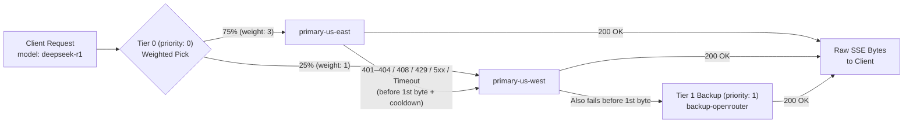

# xlite Architecture & Technical Deep Dive

`xlite` is an ultra-thin, high-concurrency OpenAI streaming load balancer written in Rust. It isolates model channel scheduling (`priority + weight + pre-first-byte failover`) into a zero-JSON-per-chunk, zero-hot-path-DB-I/O Rust data plane, while delegating byte-level L4/Thin-L7 load balancing, TLS termination, and HTTP/1.1 connection pooling to its companion project [**xLB**](https://github.com/EeroEternal/xlb).

- [1. Planes & Module Boundaries](#1-planes--module-boundaries)
- [2. Zero-Parse Data Plane (`src/proxy.rs`)](#2-zero-parse-data-plane-srcproxyrs)
- [3. Lock-Free `ArcSwap` Snapshot (`src/store.rs`)](#3-lock-free-arcswap-snapshot-srcstorers)
- [4. Priority + Weight Routing & Pre-First-Byte Failover](#4-priority--weight-routing--pre-first-byte-failover)
- [5. Native Upstream HTTP/2 Pool (`xlite-h2-pool`)](#5-native-upstream-http2-pool-xlite-h2-pool)
- [6. Two-Stage Stream Liveness, Cancellation & Diagnostics](#6-two-stage-stream-liveness-cancellation--diagnostics)
- [7. Persistence Modes & Declarative YAML Catalog](#7-persistence-modes--declarative-yaml-catalog)

---

## 1. Planes & Module Boundaries

`xlite` is compiled as a single static binary plus two transport crates (`xlite-h2-pool`, `xlite-transport`):

| Component | Path | Responsibility |
| :--- | :--- | :--- |
| **Data Plane** | `src/proxy.rs` | API key authentication (`Authorization: Bearer` & `x-api-key`), zero-DOM `"model"` extraction, channel failover loop, raw `Bytes` SSE streaming passthrough, and async usage webhook reporting (`XLITE_USAGE_WEBHOOK_URL`) |
| **Protocol Engine** | `src/protocol.rs` | Multi-protocol request/response/SSE stream translation for Anthropic `/v1/messages`, OpenAI `/v1/responses` (with automatic `/v1/chat/completions` fallback on `404`/`405`), and OpenAI `/v1/embeddings` |
| **Routing Snapshot** | `src/store.rs` | Lock-free `ArcSwap<Snapshot>` holding pre-validated channels, provider names, SHA-256 key hashes, and pre-rendered HTTP headers |
| **Upstream Client** | `src/upstream.rs` | Dispatches requests across `xlite-h2-pool` (`h2c` and TLS `ALPN: h2`) or the built-in LIFO `H1Pool` (HTTP/1.1 and HTTPS/TLS with transparent stale-socket redial) |
| **HTTP/2 Pool** | `crates/xlite-h2-pool` | Peer `SETTINGS_MAX_CONCURRENT_STREAMS`-aware HTTP/2 multiplexing pool with stream cancellation propagation |
| **Transport Client** | `crates/xlite-transport` | The `Transport` contract (one attempt per call, caller-owned retry/routing) over the extracted HTTP/1.1 pool and `xlite-h2-pool`, shared with Nebula — see [`architecture/transport-contract.md`](architecture/transport-contract.md) |
| **Control Plane & Auth** | `src/admin.rs`, `src/auth.rs` | Headless REST API (`/api/*`) authenticated via stateless `Authorization: Bearer <ADMIN_PASSWORD>`, `x-admin-token`, or HMAC-SHA256 signed session cookies |
| **Catalog Storage** | `src/catalog/` | Persistence backend (SQLite file, in-memory SQLite, or shared Redis key `xlite:catalog`) + YAML import/export (`yaml.rs`) |

See [`architecture/module-boundaries.md`](architecture/module-boundaries.md) for strict crate and module rules.

---

## 2. Zero-Parse Data Plane (`src/proxy.rs`)

Most AI gateways parse the entire inbound JSON request into a heap-allocated AST/DOM (proportional to the `messages` history size) and deserialize every outbound `data: {...}` SSE chunk to count tokens or rewrite fields.

`xlite` keeps both directions zero-parse on the common path:

1. **Zero-DOM Borrowed Model Peek**:
   ```rust
   #[derive(Deserialize)]
   struct ModelRef<'a> {
       model: Option<&'a str>,
   }
   ```
   Deserializing `ModelRef<'a>` validates JSON syntax and borrows the top-level `"model"` slice directly from the request `Bytes` buffer while `serde` skips `messages`, `tools`, and all other fields without allocating a `serde_json::Value` tree.
2. **Zero-Copy & Surgical Byte-Splice Request Forwarding**:
   - When `channel.upstream_model == requested_model`, `outbound_body()` clones the `Bytes` reference count (`O(1)`) and forwards the exact wire bytes untouched.
   - When a channel rewrites the model name (`upstream_model != model`), `xlite` scans only the top-level JSON object for the `"model"` value span (`RewritePlan::Splice`) and splices the new model string directly into a flat byte buffer—avoiding multi-megabyte `serde_json::Value` DOM allocation and `messages` re-serialization on long-context prompts (up to `XLITE_MAX_BODY_BYTES`, default `64 MiB`).
3. **Raw `Bytes` SSE Passthrough with Keep-Alive Heartbeats**:
   - Upstream response bodies are piped directly as `Bytes` frames from the socket/H2 recv stream to the client response body. `xlite` never splits lines on `\n\n`, never parses chunk JSON, and never re-allocates SSE frames.
   - On `text/event-stream` responses, `xlite` sets `Cache-Control: no-cache` and `X-Accel-Buffering: no` and emits `: keep-alive\n\n` SSE comment frames every `XLITE_SSE_KEEPALIVE_SECS` (default `15s`) during silent reasoning or prefill pauses without resetting `StallGuard`'s upstream stall deadline.

---

## 3. Lock-Free `ArcSwap` Snapshot (`src/store.rs`)

The request hot path performs **zero SQLite or Redis I/O** and acquires **zero mutexes or read-write locks**:

- **Why `ArcSwap` instead of `RwLock`**: With a standard `RwLock<Snapshot>`, a background reload writer holds the exclusive lock while swapping the snapshot (and potentially while dropping the old one), blocking concurrent request readers. With `ArcSwap<Snapshot>`, `store.inner.load()` is a wait-free atomic load; readers continue using the old `Arc<Snapshot>` until they finish, and the old snapshot is reclaimed only after the last reader guard drops.
- **No-Op Swap Suppression**: Every `XLITE_CATALOG_RELOAD_SECS` (default `5s`), `Store::reload()` builds a candidate `Snapshot` and compares it (`==`) against the active snapshot before calling `ArcSwap::store`. If nothing changed in SQLite or Redis, no pointer swap occurs and no epoch reclamation traffic is generated.
- **Precomputed Wire Shapes**: Every `Channel` inside the snapshot pre-computes its full `endpoint` URL, `:authority`, path, validated `Authorization` `(HeaderName, HeaderValue)` pair (`bearer`, `raw`, or `none`), and static `extra_headers` at snapshot build time. Malformed headers or reserved header overrides (`host`, `content-length`, `authorization`, etc.) are rejected at control-plane write time (`400 Bad Request`) and never reach the request path.

---

## 4. Priority + Weight Routing & Pre-First-Byte Failover

`xlite` implements a single, predictable scheduling rule (matching New API):

1. **Filter**: Select enabled channels for the requested public `model`, restricted by the caller API key's `allowed_model_ids` (an empty allow-list grants access to all public models).
2. **Group by Priority**: Group candidate channels by `priority` ascending (`0` is highest priority).
3. **Weighted Random Selection**: Within each priority tier, order channels using weighted random sampling without replacement (`weight / remaining_total_weight`).
4. **Pre-First-Byte Failover**:
   - `xlite` attempts channels in the resulting order.
   - If a channel fails **before response headers are committed to the client**—specifically on TCP/H2 dial errors, `XLITE_UPSTREAM_HEADER_TIMEOUT_SECS` expiry, HTTP `402 Payment Required` (account balance/quota exhaustion), HTTP `429 Too Many Requests`, or HTTP `5xx`—`xlite` transparently fails over to the next candidate channel.
   - Once an upstream returns `200 OK` (or a non-failover `4xx` like `400`/`401`), response headers are flushed immediately and the stream is bound to that channel.

There are no opaque strategy enums (`CostAware`, `LeastLatency`, etc.) or stateful session-affinity tables on the hot path.

### Example: Priority Tiering + Weighted Split + Automatic Failover

```yaml
models:
  - name: deepseek-r1
    enabled: true
    channels:
      # Tier 0 (Primary Active Pool): 75% / 25% weighted split
      - provider: primary-us-east
        upstream_model: deepseek-reasoner
        priority: 0
        weight: 3          # 3 / (3 + 1) = 75% of primary traffic
        enabled: true
      - provider: primary-us-west
        upstream_model: deepseek-reasoner
        priority: 0
        weight: 1          # 1 / (3 + 1) = 25% of primary traffic
        enabled: true

      # Tier 1 (Backup Pool): only touched if ALL Tier 0 channels fail before first byte
      - provider: backup-openrouter
        upstream_model: deepseek/deepseek-r1
        priority: 1
        weight: 1
        enabled: true
```



When a channel fails before the first byte, `xlite` records a lock-free `AtomicU64` monotonic cooldown on that `Channel` (`30s` on `401–404` quota/auth/route errors, `5s` on `408`/`429`/`5xx` and transport/header timeouts). Subsequent requests immediately order healthy channels ahead of cooling-down channels with zero extra upstream RTT, while retaining cooling-down channels at the tail so traffic is never blackholed if all channels enter cooldown simultaneously.

---

## 5. Native Upstream HTTP/2 Pool (`xlite-h2-pool`)

Standard Rust HTTP clients (`reqwest` / `hyper-util`) reuse a single HTTP/2 connection per `(scheme, host, port)`. Once in-flight streams exceed the upstream server's `SETTINGS_MAX_CONCURRENT_STREAMS` (commonly 100–250), `hyper` queues excess streams *inside that single connection* instead of opening a second TCP connection. Under load tests, `upstream_ttft` spikes into seconds while client-side queue metrics appear idle.

`crates/xlite-h2-pool` solves this for both cleartext `h2c` (`http://` with `XLITE_UPSTREAM_H2C=1`) and TLS `h2` (`https://` cloud providers such as DeepSeek, Xiaomi MiMo, OpenAI, and Anthropic via `ALPN: h2`) with Go-style peer-`SETTINGS`-aware stream accounting:

1. Reads the peer's live `SETTINGS_MAX_CONCURRENT_STREAMS` frame during the HTTP/2 handshake (optionally clamped by `XLITE_UPSTREAM_STREAM_CAP`).
2. Tracks each connection's active streams via lock-free atomics (`in_flight < cap`).
3. Reserves a slot on the first non-saturated connection; when all open connections reach `cap`, dials a new connection up to `XLITE_UPSTREAM_MAX_CONNS_PER_HOST` (default `32`).
4. Only queues acquirers when all `max_conns_per_host` connections are simultaneously at full stream capacity.
5. If an `https://` origin negotiates `http/1.1` during TLS ALPN instead of `h2`, `xlite` parks the warm TLS socket directly into its native LIFO `H1Pool` and serves the request with zero extra TLS handshake.

For high-concurrency cleartext HTTP/1.1 upstreams (where one TCP connection carries one request at a time), `xlite` also pairs with [**xLB**](https://github.com/EeroEternal/xlb)'s `thin-l7` bounded LIFO connection pool.

---

## 6. Two-Stage Stream Liveness, Cancellation & Diagnostics

1. **Header Timeout (`XLITE_UPSTREAM_HEADER_TIMEOUT_SECS`)**:
   - Covers strictly the window between *sending the upstream request* and *receiving upstream response headers*.
   - Pool queue wait and TCP dial time are intentionally excluded so legitimate backpressure under heavy load does not trigger false timeouts.
   - If the timer fires, `xlite` fails over to the next candidate channel.
2. **Mid-Stream Stall Guard (`XLITE_UPSTREAM_STALL_TIMEOUT_SECS`)**:
   - Wraps the active response stream (and error-body drain) in `StallGuard` (`src/proxy.rs`).
   - Resets the deadline on every `Poll::Ready(Some(_))` chunk; if an upstream hangs mid-stream for longer than the configured threshold, the stream terminates cleanly and releases its connection pool lease.
3. **Immediate Downstream Cancellation Propagation**:
   - In `crates/xlite-h2-pool/src/pump.rs`, the stream pump `select!`s on `out.closed()` while waiting for upstream H2 frames. If a downstream client disconnects mid-generation, `xlite` immediately drops the upstream `RecvStream` and sends `RST_STREAM(CANCEL)`—freeing the upstream stream slot even if the LLM backend is silent during long reasoning steps.
4. **Lock-Free Pool Telemetry (`GET /api/pool`)**:
   - Exposes per-host connection counts, in-flight streams, effective stream ceilings, and queue wait percentiles (`wait_ms_p50` / `wait_ms_p99`) with zero contention on the data plane. `reclaimed` counts idle connections the reaper closed; `evicted` counts connections the pool stopped trusting — evicted by a caller after a header timeout or transport error, or ended while a stream was still in flight — so a degrading upstream is visible before it is diagnosed; a routine idle close counts as neither.
5. **Startup FD Budget Self-Check (`RLIMIT_NOFILE`)**:
   - On Linux startup, `src/config.rs` inspects `/proc/self/limits` and logs an explicit warning if `Max open files` soft limit is below `65,536` (preventing the silent Docker `nofile=1024` throughput cliff documented in [Benchmarks](benchmarks.md#3-operational-root-cause-ablations)).

---

## 7. Persistence Modes & Declarative YAML Catalog

| Mode | Configuration | How It Works |
| :--- | :--- | :--- |
| **SQLite (Default)** | `DATABASE_URL=sqlite:xlite.db` | Single-node persistent file; zero external dependencies |
| **In-Memory** | `DATABASE_URL=memory` | Ephemeral in-RAM SQLite for zero-disk benchmarking and stateless deployments |
| **Redis Cluster** | `REDIS_URL=redis://...` | Stores the full catalog JSON in `xlite:catalog` (with short write lock `xlite:catalog:lock`) shared across all gateway replicas |

Both the CLI (`xlite import <file.yaml> [--replace]`, `xlite export [file.yaml]`) and the HTTP control plane (`POST /api/catalog/import`, `GET /api/catalog/export`) use the same declarative YAML schema (`src/catalog/yaml.rs`).
